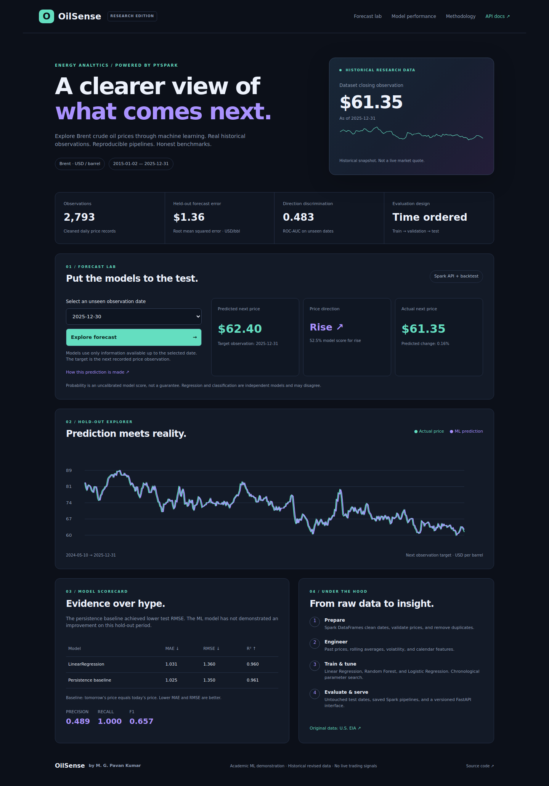

# OilSense

**Brent crude oil forecasting with PySpark ML, FastAPI, and an interactive dashboard.**

[](https://github.com/mgpavankumar/oilsense/actions/workflows/ci.yml)

Author: **M. G. Pavan Kumar** · Big Data Ecosystem, Module 5 · Academic research product



## What you can do

- Explore historical Brent prices and next-observation forecasts on unseen test dates.
- Compare real ML predictions with actual prices and a persistence baseline.
- Inspect regression and classification metrics, chronological model tuning, and data provenance.
- Train and save real Spark pipelines, reload them, and request a new prediction at the dataset cutoff.
- Use a versioned, validated API with interactive OpenAPI documentation.

A lightweight recorded-backtest mode works immediately after installation without starting Spark. It serves previously computed test predictions and explicitly labels that mode. Training enables saved-pipeline inference. No prediction values are fabricated.

## Quick start: Windows, WSL, Linux, or macOS

Use **Python 3.11** and **Java 17** for the recommended setup. Java is required for training and live Spark inference, but not for recorded-backtest serving.

```bash
git clone https://github.com/mgpavankumar/oilsense.git
cd oilsense
python -m venv .venv
```

Activate the environment:

```powershell
# Windows PowerShell
.venv\Scripts\Activate.ps1
```

```bash
# WSL / Linux / macOS
source .venv/bin/activate
```

Install and run:

```bash
python -m pip install -r requirements.txt -c requirements.lock
python -m uvicorn oilsense.api:app --host 127.0.0.1 --port 8000
```

Open **http://127.0.0.1:8000** for the dashboard and **http://127.0.0.1:8000/docs** for the API explorer.

## Train real models

Stop the server, then run:

```bash
python -m oilsense.train
python -m pytest -q
python -m uvicorn oilsense.api:app --host 127.0.0.1 --port 8000
```

Training may take a few minutes. The API detects the saved pipelines in `artifacts/`. `/health` identifies its serving mode. Download the trained models from a successful GitHub Actions run if you prefer; extract them into `artifacts/`.

For deployment, pretrain models rather than training in a web request. Use a single worker for this local Spark demo. Set `SPARK_MASTER` only when configuring your own Spark cluster. No cluster or paid hosting is provisioned by this repository.

## API example

```bash
curl -X POST http://127.0.0.1:8000/api/v1/forecast \
  -H 'Content-Type: application/json' \
  -d '{"as_of":"2025-12-30"}'
```

On PowerShell use `curl.exe`, or use the `/docs` Try it out button. Choose a date returned by `/api/v1/metadata`. The dataset cutoff can be forecast only after training; its future target date is unknown and returns `null`, rather than assuming a trading calendar.

## Honest measured results

The committed snapshot contains **2,793 observations (2015-01-02 to 2025-12-31)**. The held-out set has 416 forecasts. The selected Linear Regression achieved approximately **$1.360 RMSE**, compared with **$1.350** for persistence. Direction ROC-AUC was approximately **0.483**. These models have **not demonstrated useful superiority over the baseline**. See `web/report.json` for exact results, splits, candidate scores, and the confusion matrix.

This is a complete course implementation, not a successful trading strategy. High price-level R² does not imply profitable direction prediction.

## Module 5 coverage

| Syllabus topic | Implementation |
| --- | --- |
| MLlib data types and statistics | Spark date/double columns, vector features, descriptive statistics |
| Preprocessing and feature engineering | Invalid-price filtering, duplicate validation, lag/rolling windows, return and weekday features |
| Classification and regression | Logistic Regression, Linear Regression, Random Forest Regressor |
| Transformers and Estimators | VectorAssembler, StandardScaler / StandardScalerModel, algorithm estimators / fitted models |
| Model selection and tuning | ParamGridBuilder plus explicit chronological validation; no random time-series splits |
| Evaluation metrics | MAE, RMSE, R²; ROC-AUC, positive-class precision/recall/F1 and confusion matrix |
| Spark ML Pipeline | Repeatable assembler → scaling → model stages |
| Model persistence | PipelineModel save/load; reloaded regression prediction checked against original |
| Building a product | Responsive dashboard + FastAPI + unit/integration tests |

## Structure

```text
oilsense/features.py  Spark cleaning and temporal features
oilsense/train.py     Chronological tuning, evaluation, persistence
oilsense/api.py       API, validation, saved-model inference
web/                  Dashboard and measured backtest snapshot
data/                 Price CSV and provenance
tests/                Leakage, data quality, and API checks
docs/                 Case study, API guide, demo and operations
```

## Methodology and limits

Features at observation t use prices up to and including t; labels refer to the next available observation. Train/validation boundary labels are purged. Preprocessing is fit on training data during selection, then train+validation data for final models; the test set remains untouched. All historical selectable forecasts occur after the final model training cutoff.

The 20-observation feature window operates on valid observations, not calendar days. Historical source data may be revised and is not an archive of what was published on each past date. No live feed, geopolitical inputs, trading-calendar service, probability calibration, or scheduled updates are included. The modest daily dataset demonstrates Spark APIs; it is not evidence of big-data scale. Features and model selection would need broader walk-forward validation for real use.

## Data and references

- Original publisher: [U.S. EIA, Europe Brent Spot Price FOB](https://www.eia.gov/dnav/pet/hist/rbrteD.htm).
- CSV distributor: [datasets/oil-prices](https://github.com/datasets/oil-prices). See `data/PROVENANCE.md` for the snapshot checksum and download source.
- [Spark ML pipelines](https://spark.apache.org/docs/3.5.7/ml-pipeline.html)
- [Spark model selection](https://spark.apache.org/docs/3.5.7/ml-tuning.html)
- [FastAPI documentation](https://fastapi.tiangolo.com/)

## Operations

The default command binds localhost. Before public API hosting, add gateway authentication/rate limits, HTTPS, bounded concurrent inference, monitoring, artifact versioning, dependency scanning, and resource limits. This repository does not expose personal data or provision public API hosting. Never put secrets in GitHub. See [operations](docs/OPERATIONS.md).
